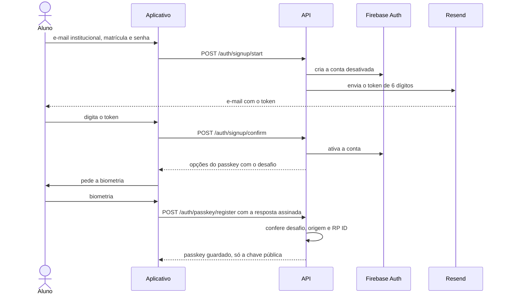
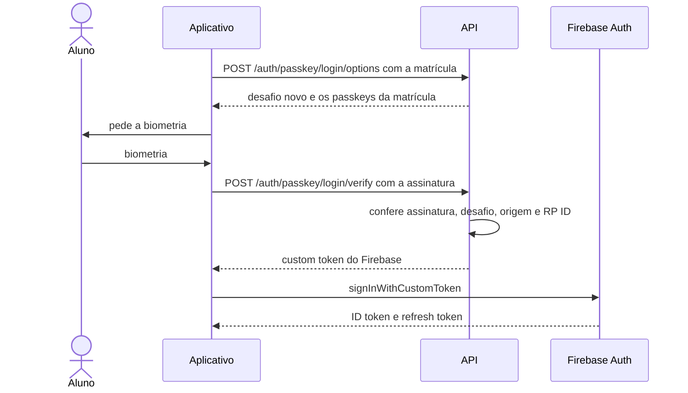
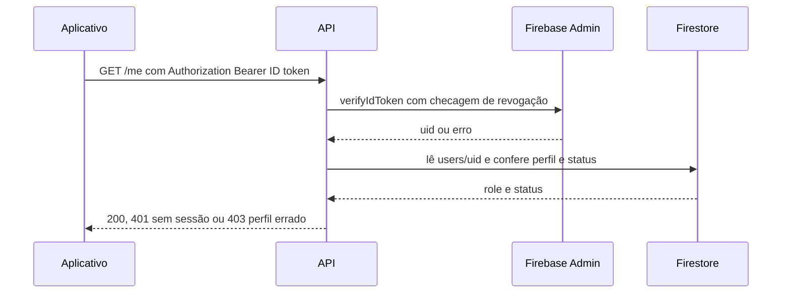
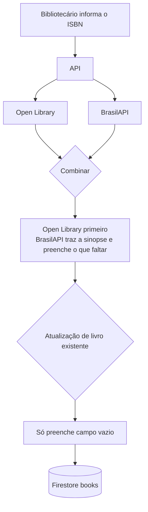

# Unifor Biblioteca — API

API REST do **Unifor Biblioteca**, o sistema de biblioteca universitária da Unifor. Trabalho de **Técnicas de Integração de Sistemas**.

- **API no ar:** <https://api.uni-books.app>
- **Documentação interativa (Swagger):** <https://api.uni-books.app/docs>
- **Verificação de saúde:** <https://api.uni-books.app/health>

Este README segue a estrutura pedida pela disciplina: 1. Apresentação do Sistema, 2. Explicação da Autenticação, 3. Documentação de Uso e 4. Integração com API Externa. No fim há um apêndice com o deploy, a estrutura de pastas e os testes.

---

## 1. Apresentação do Sistema

### Nome e descrição

**Unifor Biblioteca** é um sistema de biblioteca universitária com dois perfis de uso: o **aluno** e o **bibliotecário**. O aluno usa o aplicativo no celular para buscar livros, pedir empréstimo e acompanhar prazos, filas e multas. O bibliotecário usa o mesmo aplicativo no balcão para entregar e receber livros e para cuidar do acervo.

Esta API REST (Node.js, TypeScript e Express) concentra todas as regras de negócio, a autenticação e as permissões por perfil. O aplicativo (React Native com Expo, em outro repositório) **nunca acessa o banco de dados**: tudo passa por esta API, e as regras de segurança do Firestore negam qualquer acesso direto de cliente (`firestore.rules`).

### Casos de uso principais

#### Aluno

- Cadastrar-se com o e-mail institucional e entrar com **passkey** (biometria do celular).
- Buscar no acervo por título, autor ou assunto e abrir a página do livro (`GET /books`, `GET /books/{bookId}`).
- Pedir empréstimo (`POST /loans`) e **retirar com um QR** no balcão: o pedido tem um segredo que o aplicativo transforma em QR, e o prazo para retirar é de 2 dias úteis.
- Renovar uma vez (`POST /loans/{loanId}/renew`) ou cancelar o pedido antes da retirada.
- Entrar na fila de um livro emprestado, **vendo antes quantas pessoas há na frente** (`GET /books/{bookId}/queue/preview`, `POST /queues`), e confirmar a vez em até 24 horas.
- Consultar as multas (`GET /me/fines`). A multa é paga só no balcão; a API não recebe pagamento.
- Salvar livros e organizá-los em pastas (`/me/saved`, `/me/folders`).
- Receber avisos dentro do aplicativo, por push (Android) e por e-mail, e ligar ou desligar cada tipo (`/me/notifications`, `/me/notification-prefs`).

#### Bibliotecário

- **Balcão:** abrir a ficha do aluno pelo QR do pedido, pelo código do pedido (`RET-1234`) ou pela matrícula (`POST /librarian/desk/lookup`).
- Registrar a **retirada** e a **devolução** (`POST /librarian/loans/{loanId}/pickup` e `/return`), inclusive marcando "multa paga agora".
- Ver as retiradas pendentes e o resumo do dia (`GET /librarian/pickups`, `GET /librarian/desk/summary`).
- **Fila:** ver, adicionar, mudar a posição, reenviar o aviso e remover alguém com motivo (`/librarian/books/{bookId}/queue`, `/librarian/queues/{entryId}/...`).
- **Acervo:** cadastrar livro a partir do ISBN, editar, remover, marcar como indisponível para novos pedidos e atualizar pelas fontes externas (`/librarian/books`).
- **Multas:** listar as abertas, as que estão contando e as pagas, e registrar o pagamento (`/librarian/fines`).

#### Rotinas automáticas (Cloud Scheduler)

O Google Cloud Scheduler chama `POST /jobs/{job}` nos horários abaixo (fuso `America/Fortaleza`). Cada execução fica registrada na coleção `jobRuns`, e rodar duas vezes seguidas não repete o trabalho.

| Rotina             | Quando            | O que faz                                                                              |
| ------------------ | ----------------- | -------------------------------------------------------------------------------------- |
| `advance_queues`   | a cada 5 minutos  | Quem passou de 24 horas sem confirmar a vez sai da fila, e o próximo ganha a vez       |
| `expire_pickups`   | a cada 15 minutos | O pedido não retirado no prazo expira e o exemplar volta para a fila ou estante        |
| `due_reminders`    | todo dia, às 8h   | Lembrete 2 dias antes e no dia do vencimento, aviso de atraso e último dia de retirada |
| `accrue_fines`     | todo dia, às 6h   | Começa a contar a multa do empréstimo que passou a ter dia útil de atraso              |
| `refresh_holidays` | segunda-feira, 3h | Busca na FeriadosAPI os feriados do ano atual e do próximo, se não estiverem salvos    |

### Tipos de usuários e suas permissões

| Perfil              | Como se identifica                                            | O que pode fazer                                                                                                                                                           |
| ------------------- | ------------------------------------------------------------- | -------------------------------------------------------------------------------------------------------------------------------------------------------------------------- |
| **Sem sessão**      | Nada                                                          | Ver `/health` e `/docs`, cadastrar-se, confirmar o e-mail, recuperar a senha e pedir o login com passkey                                                                   |
| **Aluno**           | ID token do Firebase de uma conta com perfil `student`        | Acervo, empréstimos, renovação, filas, multas (só consulta), salvos e pastas, avisos, aparelhos de push, passkeys e o próprio perfil. Só vê os **seus** dados              |
| **Bibliotecário**   | ID token do Firebase de uma conta com perfil `librarian`      | Acervo (como leitor) e todas as rotas `/librarian/...`: balcão, retirada, devolução, multas, fila e gestão do acervo. Não usa passkey, avisos nem salvos, que são do aluno |
| **Cloud Scheduler** | Token OIDC do Google da conta de serviço `unibooks-scheduler` | Só `POST /jobs/{job}`. A sessão de aluno ou de bibliotecário nunca vale nessa rota, e o token do Scheduler não vale nas outras                                             |

**401 e 403.** Toda rota protegida exige sessão. Sem `Authorization: Bearer <ID token>` (ou com token vencido, revogado ou inválido), a API responde **401**. Com sessão válida, mas de um perfil que não pode usar a rota (por exemplo, um aluno chamando `/librarian/...`), responde **403**. Uma conta que ainda não confirmou o e-mail, ou que foi desativada, também recebe 403.

### Dados principais que o sistema gerencia

O banco é o **Firestore**, com 24 coleções (`docs/modelo-de-dados-firestore.md`):

| Coleção                              | O que guarda                                                       |
| ------------------------------------ | ------------------------------------------------------------------ |
| `users/{uid}`                        | Aluno ou bibliotecário: perfil, contadores e preferências de aviso |
| `matriculaIndex/{matricula}`         | Garante matrícula única e acha o usuário pela matrícula            |
| `emailIndex/{email}`                 | Garante e-mail único                                               |
| `emailTokens/{tokenId}`              | Token de 6 dígitos (confirmação e recuperação), guardado como hash |
| `passkeys/{credentialId}`            | Chave pública de cada passkey                                      |
| `passkeyChallenges/{challengeId}`    | Desafio de uso único do passkey                                    |
| `works/{workId}`                     | A obra, que agrupa as edições                                      |
| `books/{bookId}`                     | A edição que aparece no acervo                                     |
| `copies/{copyId}`                    | Cada exemplar físico                                               |
| `loans/{loanId}`                     | Pedido e empréstimo, do pedido à devolução                         |
| `queueEntries/{entryId}`             | Cada lugar de um aluno na fila de uma edição                       |
| `fines/{fineId}`                     | Multa por atraso de um empréstimo                                  |
| `users/{uid}/savedBooks/{bookId}`    | Livros salvos de cada aluno e as pastas em que estão               |
| `users/{uid}/folders/{folderId}`     | Pastas de Salvos                                                   |
| `users/{uid}/notifications/{id}`     | Avisos dentro do aplicativo                                        |
| `users/{uid}/devices/{deviceId}`     | Token de push de cada aparelho                                     |
| `users/{uid}/assistantMessages/{id}` | Conversa com o Assistente (reservada)                              |
| `users/{uid}/assistantActions/{id}`  | Ação proposta pelo Assistente (reservada)                          |
| `recommendations/{uid}`              | "Recomendados para você" (reservada)                               |
| `holidays/{ano}`                     | Feriados vindos da FeriadosAPI (cache)                             |
| `recesses/{recessId}`                | Dias de recesso, cadastrados à mão                                 |
| `settings/library`                   | Horários, regras numéricas e a data simulada de teste              |
| `auditLog/{logId}`                   | Ações do bibliotecário que pedem motivo e outras ações sensíveis   |
| `jobRuns/{runId}`                    | Registro de cada execução das rotinas agendadas                    |

As regras de negócio principais: empréstimo de 14 dias com uma renovação de 14 dias (negada se há atraso ou fila); no máximo 10 livros por aluno e 7 filas; multa de R$ 2,00 por dia útil de atraso, sem teto, congelada na devolução. Dias úteis não contam fins de semana, feriados nem recesso.

---

## 2. Explicação da Autenticação

A autenticação é **passkey (WebAuthn) com o Firebase Authentication**. O passkey é o login principal do aluno. A senha existe só como plano B.

### Como funciona

**1. Cadastro com token de 6 dígitos.** O aluno informa e-mail `@edu.unifor.br`, matrícula de 7 dígitos, senha e confirmação. A API valida o formato do e-mail, cria a conta no Firebase **desativada** e envia por e-mail (Resend) um token de **6 dígitos**. O token vale 20 minutos, é de uso único e só 5 tentativas erradas são aceitas. O aluno digita o token, e a API ativa a conta.

**2. Criação do passkey.** Ao confirmar o e-mail, a API devolve as opções do passkey com um desafio novo. O celular pede a biometria, assina o desafio e o aplicativo manda a resposta para a API, que confere o desafio, a origem do aplicativo Android e o RP ID `uni-books.app`. A API guarda **só a chave pública**.



**3. Login com passkey.**

1. O aplicativo chama `POST /auth/passkey/login/options` com a matrícula e recebe um desafio novo.
2. O celular assina o desafio com a biometria.
3. O aplicativo chama `POST /auth/passkey/login/verify`. A API confere a assinatura com a chave pública, o desafio (gasto na hora), a origem e o RP ID, e exige verificação do usuário (biometria).
4. Se tudo confere, a API devolve um **custom token** do Firebase.
5. O aplicativo troca o custom token por uma sessão com `signInWithCustomToken` do SDK do Firebase e passa a ter um **ID token**.



**4. Cada requisição protegida.** O aplicativo manda `Authorization: Bearer <ID token>`. A API confere o token com o **Firebase Admin** (`verifyIdToken`, inclusive se foi revogado) e lê o perfil (`student` ou `librarian`) em `users/{uid}`. Não existe JWT próprio.



**5. Login alternativo e recuperação de senha.**

- **Matrícula e senha:** o aplicativo entra direto no Firebase Authentication com o SDK, usando um e-mail interno montado a partir da matrícula (`<matrícula>@contas.uni-books.app`, que nunca recebe mensagens). Não há rota da API para isso. O bibliotecário entra só assim.
- **Recuperação de senha:** `POST /auth/password/recover` envia um token de 6 dígitos ao e-mail cadastrado, e `POST /auth/password/reset` confere o token e grava a nova senha no Firebase. A resposta do primeiro pedido é sempre a mesma, exista a conta ou não.

**6. Logout.** `POST /auth/logout` **revoga os refresh tokens** do usuário no Firebase, e o aplicativo também sai do Firebase. Depois disso, o ID token antigo deixa de valer na próxima conferência, porque a API confere a revogação.

### Por que escolhemos

- A disciplina pede uma autenticação **diferente das usadas pelos outros grupos**, e o passkey cumpre isso.
- **Não há senha para vazar:** o passkey não tem segredo compartilhado, e a API só guarda a chave pública.
- É **resistente a phishing:** o passkey só funciona no domínio ao qual foi criado (`uni-books.app`), então um site falso não consegue usá-lo.
- Usa a **biometria que o aluno já tem no celular**, em um toque.

### Pontos fortes

- Nenhuma senha trafega no login do dia a dia nem é guardada pela API.
- A chave privada nunca sai do aparelho.
- Cada desafio é novo e de uso único, o que impede repetir uma resposta já usada.
- A sessão é o ID token do Firebase, conferido a cada requisição com checagem de revogação, e o logout revoga os refresh tokens.
- A senha, quando existe, fica só no Firebase Authentication.

### Pontos fracos e quando não usar

- **No projeto, só Android.** Passkey e push no iOS exigem a conta paga da Apple, que o projeto não usa.
- Depende de **HTTPS, de domínio próprio e do arquivo `assetlinks.json`** (servido pelo Firebase Hosting), que liga o aplicativo Android ao domínio. Roda em build de desenvolvimento do Expo, não no Expo Go.
- **Celular perdido ou trocado** obriga a usar a alternativa: por isso a senha existe como plano B.
- **Não serve** quando o usuário não tem celular compatível com passkey ou não pode usar a biometria.
- Os passkeys dependem do RP ID `uni-books.app`: trocar o domínio invalida todos os que já foram criados.

### Implementação

**Módulo `auth` e middlewares**

```text
src/modules/auth/
  auth.routes.ts            só o caminho e os middlewares de cada rota
  auth.controller.ts        valida a entrada com o schema, chama o serviço e responde
  auth.errors.ts            erros com code em inglês e mensagem em português
  auth.constants.ts         tempos, tentativas e mensagens
  schemas/                  request.schemas.ts e response.schemas.ts (Zod)
  services/
    signup.service.ts       cadastro e confirmação do e-mail
    email-token.service.ts  token de 6 dígitos
    passkey.service.ts      opções, registro e login com passkey
    password.service.ts     recuperação e redefinição de senha
    session.service.ts      perfil e logout
  repositories/             único código que acessa o Firestore
  rules/                    funções puras (token, opções do passkey)
  mail/mailer.ts            texto do e-mail do token
src/middlewares/
  auth.ts                   authenticate: confere o ID token e lê o perfil
  require-role.ts           requireRole: libera a rota só para o perfil certo
  session.ts                studentSession e librarianSession (authenticate + requireRole)
  scheduler-auth.ts         requireScheduler: confere o token OIDC do Scheduler
  error-handler.ts          respostas de erro { code, message }
```

Os nomes dos middlewares no código são `authenticate` (exige sessão) e `requireRole` (exige o perfil). `studentSession` e `librarianSession` apenas juntam os dois, na ordem certa.

**Bibliotecas:** `@simplewebauthn/server` (passkey), `firebase-admin` (Firebase Authentication e Firestore), `zod` (validação), `express` 5 e `resend` (e-mail).

**Middleware que confere o token** (`src/middlewares/auth.ts`, resumido):

```ts
export const authenticate: RequestHandler = async (req, _res, next) => {
  const token = BEARER_HEADER.exec(req.header('authorization') ?? '')?.[1]
  if (!token) throw unauthorized()

  let uid: string
  try {
    ;({ uid } = await getAdminAuth().verifyIdToken(token, true)) // true = confere revogação
  } catch (error) {
    throw isSessionError(error) ? unauthorized() : error
  }

  const profile = await getDb().collection('users').doc(uid).get()
  const role = userRoleSchema.safeParse(profile.get('role'))
  if (!role.success) throw new AppError(403, 'profile_not_found', '...')
  if (profile.get('status') !== USER_STATUS.active) {
    throw new AppError(403, 'account_disabled', 'Sua conta não está ativa.')
  }

  req.user = { uid, role: role.data }
  next()
}
```

### Segurança

**Como protegem as senhas?** A API **nunca guarda senha**: ela fica só no Firebase Authentication, que a protege. A senha passa pela API apenas no cadastro e na redefinição, para ser entregue ao Firebase, e não é gravada nem registrada em log (o `morgan` nunca registra corpo nem cabeçalhos). O token de e-mail é guardado só como **hash SHA-256 com sal** e comparado em tempo constante.

**Existe rate limiting?** Existe de forma parcial. O que **existe**:

- **Espera de 60 segundos** entre dois envios de token (reenvio do cadastro e pedido de recuperação). No cadastro, antes disso a API responde 429 (`token_resend_too_soon`).
- **5 tentativas erradas por token**: depois disso o token fica bloqueado e é preciso pedir outro.
- **Resposta genérica** na recuperação de senha e nas opções de login com passkey: não revelam se a conta existe.
- O **Firebase Authentication** aplica, por conta própria, um bloqueio temporário depois de muitas tentativas erradas de senha (isso é do serviço, não do nosso código).

O que **não existe**: não há limite de requisições por IP ou por usuário nas rotas da API (nenhum middleware de rate limiting), nem CAPTCHA. A API fica em no máximo 2 instâncias do Cloud Run, o que limita o gasto, mas não é uma proteção contra abuso.

**Os tokens expiram?** Sim.

| Token                       | Validade                                                              |
| --------------------------- | --------------------------------------------------------------------- |
| ID token do Firebase        | 1 hora, renovado pelo SDK com o refresh token                         |
| Custom token do passkey     | Até 1 hora (padrão do Firebase), mas é trocado na hora por uma sessão |
| Token de e-mail (6 dígitos) | 20 minutos, uso único, 5 tentativas                                   |
| Desafio do passkey          | 5 minutos, uso único (é gasto antes da verificação)                   |
| Refresh tokens              | Revogados no logout e quando a senha é redefinida                     |

#### Outras proteções

- O Firestore apaga sozinho, por **TTL no campo `expiresAt`**, os documentos vencidos de `emailTokens`, `passkeyChallenges` e `assistantActions` (a remoção pode demorar até 24 horas; por isso a API sempre confere `expiresAt` antes de aceitar).
- Chaves e segredos (Resend, FeriadosAPI e Gemini) ficam no **Secret Manager** em produção e num `.env` fora do Git no desenvolvimento. O repositório é público e só tem os **nomes** das variáveis.
- As **regras do Firestore negam todo acesso de cliente** (`allow read, write: if false`): só o Admin SDK, usado por esta API, lê e grava.
- Todo o tráfego usa HTTPS, com domínio próprio.

---

## 3. Documentação de Uso

### Como rodar o projeto

#### Requisitos

- Node.js 24 (LTS)
- Java 21 ou superior (para os emuladores do Firebase)
- [Firebase CLI](https://firebase.google.com/docs/cli): `npm install -g firebase-tools`
- [Google Cloud CLI](https://cloud.google.com/sdk/docs/install) (`gcloud`), só para o deploy

#### Passo a passo

1. Clone e instale as dependências:

   ```sh
   git clone https://github.com/gustavuhh1/unifor-biblioteca-api.git
   cd unifor-biblioteca-api
   npm install
   ```

2. Crie o arquivo de ambiente. Ele é ignorado pelo Git: nunca faça commit dele.

   ```sh
   cp .env.example .env
   ```

   Os valores padrão já apontam para os emuladores. Defina `SEED_TEST_PASSWORD` com a senha que as contas de teste vão ter. As chaves do Resend, da FeriadosAPI e do Gemini podem ficar em branco: sem a chave do Resend, o token de e-mail é escrito no console do servidor, e só quando a API fala com os emuladores.

3. Suba os emuladores do Firebase (Firestore em `8085`, Auth em `9099`, interface em `4000`):

   ```sh
   npm run emulators
   ```

4. Em outro terminal, carregue os dados de demonstração e suba a API (reinicia ao salvar):

   ```sh
   npm run seed
   npm run dev
   ```

   - Saúde: <http://localhost:8080/health>
   - Swagger: <http://localhost:8080/docs>

5. Teste a API local. No emulador, o ID token vem do emulador do Firebase Auth (a chave pode ser qualquer texto):

   ```sh
   curl -i http://localhost:8080/health

   TOKEN=$(curl -s "http://127.0.0.1:9099/identitytoolkit.googleapis.com/v1/accounts:signInWithPassword?key=fake" \
     -H 'content-type: application/json' \
     -d "{\"email\":\"2412858@contas.uni-books.app\",\"password\":\"$SEED_TEST_PASSWORD\",\"returnSecureToken\":true}" \
     | node -pe "JSON.parse(require('fs').readFileSync(0,'utf8')).idToken")

   curl -i http://localhost:8080/me -H "Authorization: Bearer $TOKEN"
   ```

O `seed` cria 12 contas (11 alunos e 1 bibliotecário), livros, exemplares, empréstimos, filas, multas, salvos e avisos. Todas as datas partem do dia em que ele roda, e pode ser executado de novo a qualquer momento. As contas de teste nascem **sem e-mail de aviso**, porque os endereços são fictícios. Para gravar em produção é preciso `--prod` e digitar o ID do projeto (veja o apêndice).

**Variáveis de ambiente** (só os nomes; os valores ficam no seu `.env` e, em produção, no Secret Manager):

| Variável                                                  | Para que serve                                                              | Segredo           |
| --------------------------------------------------------- | --------------------------------------------------------------------------- | ----------------- |
| `NODE_ENV`                                                | Ambiente (`development` ou `production`)                                    | Não               |
| `PORT`                                                    | Porta do servidor (o Cloud Run define sozinho; padrão 8080)                 | Não               |
| `GOOGLE_CLOUD_PROJECT`                                    | Projeto do Google Cloud e do Firebase                                       | Não               |
| `FIRESTORE_EMULATOR_HOST` e `FIREBASE_AUTH_EMULATOR_HOST` | Endereço dos emuladores. **Nunca definir em produção**                      | Não               |
| `PASSKEY_RP_ID`                                           | Domínio do passkey (`uni-books.app`). Não mudar: invalida os passkeys       | Não               |
| `PASSKEY_ANDROID_ORIGINS`                                 | Origem do aplicativo Android (hash do certificado), obrigatória em produção | Não               |
| `AUTH_EMAIL_DOMAIN`                                       | Domínio do e-mail interno das contas do Firebase                            | Não               |
| `EMAIL_FROM`                                              | Remetente dos e-mails                                                       | Não               |
| `RESEND_API_KEY`                                          | Chave do Resend, para enviar e-mails                                        | **Sim**           |
| `FERIADOS_API_KEY`                                        | Chave da FeriadosAPI, para os feriados                                      | **Sim**           |
| `GEMINI_API_KEY` e `GEMINI_MODEL`                         | Reservadas ao Assistente de IA (ainda não implementado)                     | **Sim** (a chave) |
| `SEED_TEST_PASSWORD`                                      | Senha das contas de teste criadas pelo seed (só no `.env` local)            | **Sim**           |

### Exemplos de requisições funcionando

Todos os exemplos abaixo foram executados de verdade contra <https://api.uni-books.app>, com as contas de teste do seed (aluno `2412858` e bibliotecário `0900001`). Nos resultados, o e-mail e o segredo do QR foram omitidos de propósito.

**Preparação:** defina as variáveis de ambiente. A chave de API web do Firebase não é segredo (fica em Google Cloud, em APIs e serviços, em Credenciais, com o nome "Browser key (auto created by Firebase)"). A senha das contas de teste vem do seu `.env` e **nunca** deve aparecer no comando.

```sh
export API=https://api.uni-books.app
export FIREBASE_WEB_API_KEY=<chave de API web do projeto>
export SEED_TEST_PASSWORD=<senha das contas de teste>   # lida do .env, sem escrever no comando
```

**1. Saúde da API** (sem sessão)

```sh
curl -i $API/health
```

```text
HTTP/1.1 200 OK
{"status":"ok"}
```

**2. Obter o ID token de uma conta de teste.** O aplicativo faz isso com o SDK do Firebase; aqui usamos a API REST do Firebase Authentication. A senha vem da variável de ambiente.

```sh
login() {
  curl -s "https://identitytoolkit.googleapis.com/v1/accounts:signInWithPassword?key=$FIREBASE_WEB_API_KEY" \
    -H 'content-type: application/json' \
    -d "{\"email\":\"$1@contas.uni-books.app\",\"password\":\"$SEED_TEST_PASSWORD\",\"returnSecureToken\":true}" \
    | node -pe "JSON.parse(require('fs').readFileSync(0,'utf8')).idToken"
}

ALUNO=$(login 2412858)         # conta de aluno do seed
BIBLIOTECARIO=$(login 0900001) # conta de bibliotecário do seed
```

No Windows, se o `curl` reclamar de `CRYPT_E_REVOCATION_OFFLINE`, acrescente `--ssl-no-revoke` a este comando.

**3. `GET /me`** (qualquer sessão)

```sh
curl -i $API/me -H "Authorization: Bearer $ALUNO"
```

```text
HTTP/1.1 200 OK
{"uid":"uid_lucas","role":"student","status":"active","matricula":"2412858","email":"<omitido>","fullName":"Lucas Almeida","initials":"LA","course":"Ciência da Computação","entryYear":2024,"deskLabel":null,"activeLoanCount":4,"activeQueueCount":1,"openFineTotalCents":0,"booksReadByYear":{"2026":17},"notificationPrefs":{"queueTurn":true,"overdueAndFines":true,"dueReminders":true,"pickupReady":true,"queueUpdates":true,"returnConfirmed":true,"channelPush":true,"channelEmail":false},"onboardingSeenAt":null}
```

**4. Buscar um livro** (qualquer sessão)

```sh
curl "$API/books?q=anatomia&pageSize=1" -H "Authorization: Bearer $ALUNO"
```

```text
{"items":[{"id":"book_anatomia_humana","title":"Anatomia Humana","authors":[],"coverUrl":null,"coverTone":5,"copiesTotal":1,"copiesAvailable":1,"queueLength":0,"nextReturnAt":null,"unavailableForNewRequests":false}],"page":1,"pageSize":1,"total":1,"totalPages":1}
```

**5. Rota de aluno: pedir empréstimo** (`POST /loans`)

```sh
curl -i -X POST $API/loans \
  -H "Authorization: Bearer $ALUNO" \
  -H 'content-type: application/json' \
  -d '{"bookId":"book_anatomia_humana"}'
```

```text
HTTP/1.1 201 Created
{"id":"439ZCZeAFlonDVAEanLI","bookId":"book_anatomia_humana","bookTitle":"Anatomia Humana","bookShelf":"","status":"awaiting_pickup","state":"ready_for_pickup","requestedAt":"2026-10-26T17:04:57.780Z","pickupDeadline":"2026-10-29T00:55:00.000Z","pickupCode":"RET-1893","qrToken":"<segredo do QR>","pickedUpAt":null,"dueAt":null,"originalDueAt":null,"renewalCount":0,"canRenew":false,"renewalDenialReason":null,"progress":0,"returnedAt":null,"cancelledAt":null,"expiredAt":null}
```

O `qrToken` é o segredo que o aplicativo transforma em QR para o balcão. O `id` do pedido (`LOAN` abaixo) é usado nas rotas do bibliotecário.

#### 6. Rota de bibliotecário: retirada e devolução

```sh
LOAN=439ZCZeAFlonDVAEanLI   # o "id" do pedido acima

# retirada: o empréstimo de 14 dias começa a contar
curl -i -X POST $API/librarian/loans/$LOAN/pickup -H "Authorization: Bearer $BIBLIOTECARIO"

# devolução
curl -i -X POST $API/librarian/loans/$LOAN/return \
  -H "Authorization: Bearer $BIBLIOTECARIO" \
  -H 'content-type: application/json' \
  -d '{"finePaidNow":false}'
```

```text
HTTP/1.1 200 OK
{"loan":{"id":"439ZCZeAFlonDVAEanLI","bookId":"book_anatomia_humana","bookTitle":"Anatomia Humana","bookShelf":"","status":"active","state":"in_progress","pickupCode":null,"pickupDeadline":"2026-10-29T00:55:00.000Z","pickedUpAt":"2026-10-26T17:04:59.120Z","dueAt":"2026-11-10T00:55:00.000Z","returnedAt":null,"progress":0}}

HTTP/1.1 200 OK
{"loan":{"id":"439ZCZeAFlonDVAEanLI","bookId":"book_anatomia_humana","bookTitle":"Anatomia Humana","bookShelf":"","status":"returned","state":"returned","pickupCode":null,"pickupDeadline":"2026-10-29T00:55:00.000Z","pickedUpAt":"2026-10-26T17:04:59.120Z","dueAt":"2026-11-10T00:55:00.000Z","returnedAt":"2026-10-26T17:05:00.141Z","progress":null},"fine":null,"queueNotified":false}
```

Devolvido no prazo, o livro não gera multa (`"fine":null`) e ninguém estava na fila (`"queueNotified":false`).

### Como autenticar em cada endpoint protegido

Todo endpoint protegido recebe o cabeçalho `Authorization: Bearer <ID token do Firebase>`. O que muda é o perfil exigido:

| Rotas                                                                                                                                                                                                                                                                                                                                                                                           | Perfil exigido              | Cabeçalho                                           |
| ----------------------------------------------------------------------------------------------------------------------------------------------------------------------------------------------------------------------------------------------------------------------------------------------------------------------------------------------------------------------------------------------- | --------------------------- | --------------------------------------------------- |
| `GET /health`, `/docs`                                                                                                                                                                                                                                                                                                                                                                          | Nenhum                      | Nenhum                                              |
| `POST /auth/signup/start`, `/auth/signup/confirm`, `/auth/signup/resend`, `/auth/password/recover`, `/auth/password/reset`, `/auth/passkey/register`, `/auth/passkey/login/options`, `/auth/passkey/login/verify`                                                                                                                                                                               | Nenhum (públicas)           | Nenhum                                              |
| `GET /me`, `POST /auth/logout`, `GET /books`, `GET /books/{bookId}`                                                                                                                                                                                                                                                                                                                             | Qualquer sessão             | `Authorization: Bearer <ID token>`                  |
| `PATCH /me`, `/auth/passkeys`, `POST /loans`, `/loans/{loanId}/cancel`, `/loans/{loanId}/renew`, `GET /me/loans`, `GET /books/{bookId}/queue/preview`, `POST /queues`, `/queues/{entryId}/leave`, `/queues/{entryId}/confirm`, `GET /me/queues`, `GET /me/fines`, `/me/saved`, `/me/folders`, `/me/notifications`, `PATCH /me/notification-prefs`, `/me/devices/{deviceId}`                     | Aluno (`student`)           | `Authorization: Bearer <ID token do aluno>`         |
| `/librarian/books`, `/librarian/books/{bookId}`, `/librarian/books/{bookId}/sync`, `/librarian/books/isbn/{isbn}`, `/librarian/books/{bookId}/queue`, `/librarian/queues/{entryId}/...`, `/librarian/desk/lookup`, `/librarian/desk/summary`, `/librarian/pickups`, `/librarian/loans/{loanId}/pickup`, `/librarian/loans/{loanId}/return`, `/librarian/fines`, `/librarian/fines/{fineId}/pay` | Bibliotecário (`librarian`) | `Authorization: Bearer <ID token do bibliotecário>` |
| `POST /jobs/{job}`                                                                                                                                                                                                                                                                                                                                                                              | Cloud Scheduler             | `Authorization: Bearer <token OIDC do Google>`      |

A lista completa, com os corpos e as respostas de cada rota, está no Swagger (`/docs`).

### Exemplos de erro

Todo erro tem o mesmo formato: `{ "code": "...", "message": "..." }`. O `code` é estável e em inglês; a `message` é em português e é a que o aplicativo mostra.

#### 401: sem token

```sh
curl -i $API/me
```

```text
HTTP/1.1 401 Unauthorized
{"code":"unauthorized","message":"Sua sessão expirou ou é inválida. Entre novamente."}
```

#### 403: aluno em rota de bibliotecário

```sh
curl -i $API/librarian/pickups -H "Authorization: Bearer $ALUNO"
```

```text
HTTP/1.1 403 Forbidden
{"code":"forbidden","message":"Você não tem permissão para acessar este recurso."}
```

**409: regra de negócio** (devolver de novo um livro que já foi devolvido)

```sh
curl -i -X POST $API/librarian/loans/$LOAN/return \
  -H "Authorization: Bearer $BIBLIOTECARIO" \
  -H 'content-type: application/json' \
  -d '{"finePaidNow":false}'
```

```text
HTTP/1.1 409 Conflict
{"code":"loan_not_active","message":"Só dá para registrar a devolução de um livro que está com o aluno."}
```

### Versão no ar

- **API:** <https://api.uni-books.app>
- **Swagger (documentação interativa):** <https://api.uni-books.app/docs>

#### Testar online pelo Swagger

1. Obtenha um ID token como no exemplo 2 acima.
2. Abra <https://api.uni-books.app/docs>.
3. Clique no botão **Authorize** (cadeado), no topo da página.
4. No campo `bearerAuth`, cole **só o ID token** (sem a palavra `Bearer`) e clique em **Authorize**.
5. Abra uma rota, clique em **Try it out**, preencha o que for pedido e clique em **Execute**. As rotas com cadeado passam a enviar o token.

O token vale 1 hora. Passado esse tempo, obtenha outro.

---

## 4. Integração com API Externa

### Como a API se integra

A API fala com serviços externos em quatro frentes:

| Serviço                                 | Para que serve                                                       | Onde é chamado                                                                             |
| --------------------------------------- | -------------------------------------------------------------------- | ------------------------------------------------------------------------------------------ |
| **Open Library** e **BrasilAPI (ISBN)** | Dados dos livros: título, autores, capa, assuntos e sinopse          | Cadastro e atualização de livro (rotas do bibliotecário) e o script `npm run catalog:sync` |
| **FeriadosAPI**                         | Feriados de Fortaleza, para o cálculo de dias úteis, prazos e multas | Leitura do calendário e rotina `refresh_holidays`                                          |
| **Resend**                              | Envio de e-mail (token de cadastro e recuperação, avisos)            | Cadastro, recuperação de senha e entrega de avisos                                         |
| **Expo Push**                           | Notificação push no Android                                          | Entrega de avisos                                                                          |
| **Gemini** (reservado)                  | Assistente de IA                                                     | **Ainda não implementado:** só as variáveis de ambiente e o módulo vazio existem           |

A integração principal da disciplina é a de **livros**: duas APIs públicas, sem chave, consultadas **ao mesmo tempo** e combinadas com os dados locais.

### Quais dados são consultados

Para cada ISBN, a API faz **duas requisições em paralelo**, cada uma com tempo máximo de **5 segundos** e com o cabeçalho `User-Agent: UniBooks/1.0 (+https://uni-books.app)`.

1. **Open Library:** título, subtítulo, autores, editora, ano, assuntos e capa.

   ```text
   GET https://openlibrary.org/api/books?bibkeys=ISBN:9780132350884&format=json&jscmd=data
   ```

2. **BrasilAPI:** os mesmos campos, mais a **sinopse**.

   ```text
   GET https://brasilapi.com.br/api/isbn/v1/9788535914849
   ```

Os feriados vêm de uma chamada por ano à FeriadosAPI (com a chave no cabeçalho `Authorization`, que nunca aparece aqui):

```text
GET https://feriadosapi.com/api/v1/feriados/cidade/2304400?ano=2026
```

`2304400` é o código IBGE de Fortaleza. Uma única chamada traz os feriados nacionais, os do Ceará e os do município.

### Como os dados são combinados



**Regras da combinação** (`src/modules/catalog/rules/book-metadata.rules.ts`):

- A **Open Library vem primeiro** em título, autores, capa e assuntos. A **BrasilAPI traz a sinopse** e **preenche o que a Open Library deixou vazio**.
- Se só uma fonte achou o ISBN, vale ela. Se nenhuma achou e alguma não respondeu, a API não afirma que o ISBN não existe (resposta 502), e o bibliotecário preenche à mão.
- **Cadastro** (`GET /librarian/books/isbn/{isbn}` e `POST /librarian/books`): a consulta pré-preenche o formulário, o que o bibliotecário confirma é o que vale, e a API registra a origem dos dados (`external`, `mixed` ou `manual`).
- **Atualização** (`POST /librarian/books/{bookId}/sync` e `npm run catalog:sync`): **só preenche campo vazio**. Título, subtítulo, autores, editora, ano, sinopse, capa e assuntos nunca sobrescrevem um valor que já existe.
- A atualização **nunca muda CDU, Cutter, estante, idioma nem exemplares**: esses dados são do bibliotecário.
- **A busca e a página do livro nunca chamam a API externa.** Só o cadastro e a atualização chamam.
- **Se a API externa falhar** (rede, tempo esgotado ou resposta fora do formato), a API usa o que já está salvo, e uma fonte fora do ar não impede a outra de responder.
- **Feriados:** uma chamada por ano, guardada em cache no Firestore (`holidays/{ano}`), por causa do limite de 60 requisições por minuto da FeriadosAPI. Se a FeriadosAPI falhar, a API segue com os feriados já salvos.

---

## Apêndice

### Deploy

A API roda no **Google Cloud Run** (serviço `unibooks-api`, região `southamerica-east1`, projeto `estoque-pay`) e é publicada em `https://api.uni-books.app` pelo **Firebase Hosting**, que repassa todas as requisições ao Cloud Run (inclusive o cabeçalho `Authorization`). As chaves do Resend, da FeriadosAPI e do Gemini vêm do **Secret Manager** (`resend-api-key`, `feriados-api-key`, `gemini-api-key`, sempre a versão `latest`); as demais variáveis vêm do seu `.env`. **Cada comando abaixo pede que você digite o ID do projeto antes de tocar a produção.**

1. Regras, índices e TTL do Firestore (os TTLs estão em `firestore.indexes.json`):

   ```sh
   npm run deploy:firestore
   ```

2. Imagem no Cloud Build, Artifact Registry e Cloud Run (0 a 2 instâncias, acesso público: as rotas são protegidas pelo ID token dentro da API). Exige a árvore do Git limpa, porque a imagem leva o commit como tag:

   ```sh
   npm run deploy
   ```

3. Jobs do **Cloud Scheduler** (cria a conta de serviço `unibooks-scheduler` e os 5 jobs; pode rodar de novo, que ele atualiza). Rode **depois** do passo 2:

   ```sh
   npm run deploy:scheduler
   gcloud scheduler jobs run unibooks-advance-queues --location=southamerica-east1   # roda um agora
   ```

4. Só quando o `firebase.json` ou o `assetlinks.json` mudarem, o Hosting:

   ```sh
   npx firebase deploy --only hosting --project estoque-pay
   ```

**Conferência depois do deploy:** `GET /health` responde 200 e `/docs` abre; `GET /me` sem token responde 401 e `POST /jobs/accrue_fines` sem token também; `https://uni-books.app/.well-known/assetlinks.json` responde 200; cada requisição aparece no Cloud Logging como uma linha do `morgan` (`/health` não é registrado).

Outros comandos úteis:

| Comando                | O que faz                                                                                                         |
| ---------------------- | ----------------------------------------------------------------------------------------------------------------- |
| `npm run seed`         | Carrega os dados de demonstração (emuladores por padrão). Com `--prod`, grava na produção e pede confirmação      |
| `npm run catalog:sync` | Atualiza os livros com ISBN pela Open Library e pela BrasilAPI (emuladores por padrão; `--prod` pede confirmação) |
| `npm run build`        | Compila para `dist/`                                                                                              |
| `npm start`            | Roda o servidor compilado                                                                                         |

### Estrutura de pastas

Cada módulo de `src/modules/<módulo>/` tem as mesmas camadas, e uma requisição segue **rota → controller → service → repository**:

```text
src/
  app.ts, server.ts      Express e ponto de entrada
  config/                variáveis de ambiente (Zod) e Firebase Admin
  middlewares/           sessão, perfil, erros, log, entrega de avisos, Scheduler
  modules/
    auth/                cadastro, token de e-mail, passkeys, senha, sessão
    catalog/             acervo, página do livro, gestão do acervo, Open Library e BrasilAPI
    loans/               pedidos, renovação, cancelamento, expiração, lembretes
    queues/              filas e a vez do primeiro
    fines/               cálculo, congelamento e pagamento da multa
    desk/                balcão: ficha, retirada, devolução, retiradas, resumo
    saved/               livros salvos e pastas
    notifications/       avisos, push, e-mail, preferências, aparelhos
    jobs/                rotinas do Cloud Scheduler
    assistant/           reservada ao Assistente (ainda sem código)
  shared/                tipos, calendário e dias úteis, repositórios usados por mais de um módulo
  docs/                  documento OpenAPI (Swagger)
  test-support/          Firestore em memória e apoio dos testes
scripts/                 seed, catalog:sync e scripts de deploy
docs/                    documentos do projeto (escopo, requisitos, modelo de dados)
```

Dentro de cada módulo: `*.routes.ts` (só o caminho e os middlewares), `*.controller.ts` (valida e responde), `*.docs.ts` (Swagger, escrito antes do código), `*.errors.ts`, `schemas/` (Zod), `services/` (o fluxo e as transações), `repositories/` (único código que acessa o Firestore), `rules/` (funções puras) e `__tests__/`. Toda escrita que mexe em mais de um documento usa transação do Firestore.

### Testes

Os testes são **unitários** (Vitest), sem testes de ponta a ponta. Cobrem as regras de negócio, as validações, as datas e dias úteis, e os serviços, que rodam contra um Firestore em memória (`src/test-support/fake-firestore.ts`). As rotas têm testes de 401 e 403. No momento são **126 arquivos de teste e 1.500 testes**.

```sh
npm test               # roda todos os testes
npm run test:watch     # roda de novo ao salvar
npm run typecheck      # tipos (TypeScript strict)
npm run lint           # ESLint
npx prettier --check . # formatação
npm run build          # compila
```

Convenções do código: nomes em inglês, comentários e textos dos testes em português, dinheiro em centavos, datas gravadas em UTC e calculadas em `America/Fortaleza`, sem ponto e vírgula (Prettier).

### Mais documentação

Os documentos do projeto estão em `docs/`: `escopo.md`, `requisitos.md` (85 requisitos funcionais e 28 não funcionais, com a situação da API), `modelo-de-dados-firestore.md`, `regras-e-decisoes.md`, `api-decisoes-tecnicas.md` e `infra.md`.
